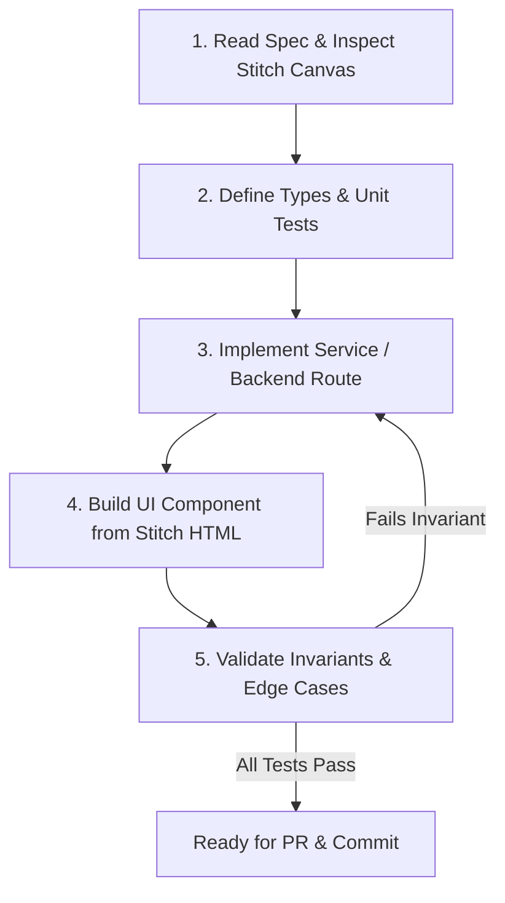

# Autonomous Agent Guidelines & Workflows (`agents.md`)
## Trevoo — Engineering Standards for Autonomous Agents

---

### 1. Agent Roles & Operational Scopes

When executing tasks in this codebase, autonomous AI agents operate under designated engineering personas:

| Agent Role | Primary Focus | Allowed Scopes & File Paths |
| :--- | :--- | :--- |
| **Architect Agent** | Schema design, API contracts, state management topology | `PRD.md`, `architecture.md`, `prisma/`, `src/types/` |
| **Fullstack Engine Agent** | Backend services, routing algorithms, Gemini LLM integrations | `src/services/`, `src/app/api/`, `src/lib/`, `server.js` |
| **UI/UX Design Systems Agent** | Component creation, Stitch token translation, responsive layouts | `src/components/`, `src/app/`, `tailwind.config.ts`, `*.html` |
| **Quality & Verification Agent** | Unit testing, physics validation tests, accessibility audits | `tests/`, `*.test.ts`, `*.spec.ts`, CI workflows |

---

### 2. Coding Conventions & Standards

#### 2.1 TypeScript Standards
* **Strict Typing**: `strict: true` in `tsconfig.json`. The use of `any` is strictly prohibited. Use explicit generics, unknown with type narrowing, or Zod schemas.
* **Type Definition Placement**: Shared domain types belong in `src/types/`. Component-specific props must be co-located with the component in `Component.types.ts` or exported directly from `Component.tsx`.
* **Nullability Handling**: Prefer `null` over `undefined` for database fields; handle optional props with default destructuring.

#### 2.2 Naming Conventions
* **React Components**: PascalCase (e.g., `TransitRibbon.tsx`, `TelemetryGauge.tsx`).
* **Utility Files & Hooks**: camelCase (e.g., `useRoutePhysics.ts`, `formatCurrency.ts`).
* **Database Models**: PascalCase in Prisma schema; snake_case mapped in database (e.g. `HeritageSite` $\to$ `@@map("heritage_sites")`).
* **API Endpoints**: kebab-case with versioning (e.g., `/api/v1/calendar/optimize-window`).

#### 2.3 File Co-location & Organization
Components must follow atomic design grouping with co-located tests:
```
src/components/molecules/TransitRibbon/
├── TransitRibbon.tsx           # Component implementation
├── TransitRibbon.types.ts     # Props interfaces
├── TransitRibbon.test.tsx      # Vitest / React Testing Library unit test
└── index.ts                    # Public barrel export
```

#### 2.4 Design System & Tailwind Utility Rules
* **Stitch Color Mapping**:
  * Dark Mode obsidian base $\to$ `bg-[#101211]` or `bg-obsidian`
  * Elevated surfaces $\to$ `bg-[#1A1D1C]` or `bg-surface-elevated`
  * Text content $\to$ `text-[#E7D4BB]` (Parchment) or `text-[#FAF8F5]`
  * High-visibility alerts $\to$ `bg-[#F97316]` (Alert Orange)
  * Authority navy $\to$ `bg-[#002046]` (Safety Navy)
* **No Inline Style Hacks**: Avoid ad-hoc `style={{ ... }}` unless calculating dynamic physics coordinates on the canvas. Always use Tailwind utility classes.

---

### 3. Component Blueprint: Stitch-to-Code Translation

Every UI component originating from a Google Stitch screen must adhere to the standard blueprint below:

```typescript
// src/components/molecules/TransitRibbon/TransitRibbon.types.ts
export type TransitMode = 'PRIVATE_CHAUFFEUR' | 'FOOT_TRANSIT' | 'SOLAR_BOAT' | 'CHARTER_FLIGHT';

export interface TransitRibbonProps {
  /** Mode of transit between heritage waypoints */
  mode: TransitMode;
  /** Estimated transit duration in minutes */
  durationMinutes: number;
  /** Distance in kilometers */
  distanceKm?: number;
  /** Traffic status flag (e.g., "Low Traffic", "Shaded Alley") */
  trafficCondition?: string;
  /** Whether the path is live GPS-calibrated */
  isGpsCalibrated?: boolean;
  /** Optional custom class overrides */
  className?: string;
}
```

```tsx
// src/components/molecules/TransitRibbon/TransitRibbon.tsx
'use client';

import React from 'react';
import { Car, Footprints, Ship, Plane, Compass } from 'lucide-react';
import { TransitRibbonProps, TransitMode } from './TransitRibbon.types';

const MODE_ICON_MAP: Record<TransitMode, React.ReactNode> = {
  PRIVATE_CHAUFFEUR: <Car className="w-4 h-4 text-emerald-400" aria-hidden="true" />,
  FOOT_TRANSIT: <Footprints className="w-4 h-4 text-amber-400" aria-hidden="true" />,
  SOLAR_BOAT: <Ship className="w-4 h-4 text-teal-400" aria-hidden="true" />,
  CHARTER_FLIGHT: <Plane className="w-4 h-4 text-sky-400" aria-hidden="true" />,
};

export const TransitRibbon: React.FC<TransitRibbonProps> = ({
  mode,
  durationMinutes,
  distanceKm,
  trafficCondition = 'Low Traffic',
  isGpsCalibrated = true,
  className = '',
}) => {
  return (
    <div
      role="region"
      aria-label={`Transit segment: ${durationMinutes} minutes via ${mode.replace('_', ' ').toLowerCase()}`}
      className={`my-3 px-4 py-2.5 rounded-xl bg-slate-900/60 border border-slate-800/80 backdrop-blur-sm flex items-center justify-between gap-4 text-xs ${className}`}
    >
      <div className="flex items-center gap-2.5">
        <span className="p-1.5 rounded-lg bg-slate-800/90 flex items-center justify-center">
          {MODE_ICON_MAP[mode] || <Compass className="w-4 h-4 text-slate-400" />}
        </span>
        <span className="font-semibold text-slate-200">
          {mode.replace('_', ' ')} • {durationMinutes} mins
        </span>
        {distanceKm && (
          <span className="text-slate-500 font-mono">({distanceKm} km)</span>
        )}
      </div>

      <div className="flex items-center gap-2">
        <span className="px-2 py-0.5 rounded-full bg-emerald-950/60 text-emerald-300 border border-emerald-800/50 text-[11px] font-medium">
          {trafficCondition}
        </span>
        {isGpsCalibrated && (
          <span className="hidden sm:inline-flex items-center gap-1 text-[11px] text-slate-400">
            <span className="w-1.5 h-1.5 rounded-full bg-teal-400 animate-pulse" />
            Live GPS Calibrated
          </span>
        )}
      </div>
    </div>
  );
};
```

---

### 4. Step-by-Step Feature Implementation Loop

When assigned to build or update any feature from the Stitch design suite, agents must strictly follow this **5-step validation loop**:



#### Step 1: Read Spec & Inspect Stitch Canvas
* Inspect the corresponding screen file (e.g., `S3_DateSelection.html`, `S7_Builder.html`).
* Cross-reference requirements in `PRD.md` and data structures in `architecture.md`.
* Identify typography families, spacing tokens, and color values.

#### Step 2: Define Types & Unit Tests
* Create/update domain DTOs in `src/types/`.
* Write unit tests defining expected output before implementing code:
  * Example: Test that `calculateDailyCapacity(stops)` throws an error if total hours exceed 8.0.
  * Example: Test that `validateBacktracking(route)` flags opposite directional vectors.

#### Step 3: Implement Backend / Engine Logic
* Write the service method in `src/services/` or route handler in `src/app/api/`.
* Verify database queries use spatial indexes where appropriate.
* Wrap third-party API calls (e.g., Gemini LLM) with deterministic fallbacks.

#### Step 4: Build UI Component from Stitch Specifications
* Convert raw Stitch HTML into modular, clean React/Next.js components.
* Ensure all interactive states are implemented:
  * Default / Normal state
  * Hover / Focus state with visible focus ring
  * Active / Pressed state
  * Disabled / Loading / Shimmer state
  * Error boundary state

#### Step 5: Validate Invariants & Edge Cases
* Run the verification checklist:
  * [ ] 0% Backtracking invariant upheld?
  * [ ] Afternoon thermal reprieve protected (no outdoor stops 1:00 PM – 3:45 PM)?
  * [ ] Capacity $\le 8.0\text{ hours}$?
  * [ ] Screen reader announcements configured for dynamic telemetry?
  * [ ] Responsive across $390\text{px}$ (mobile) and $1440\text{px}$ (desktop)?
  * [ ] TypeScript compiles cleanly with zero errors (`tsc --noEmit`)?

