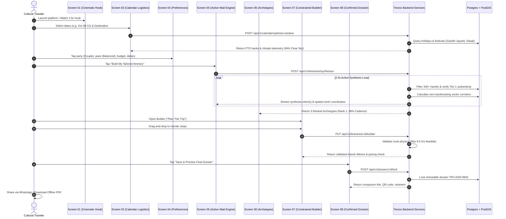

# Quick-Reference Architecture (`architecture-essential.md`)
## Trevoo — Foundational Engineering Reference

---

### 1. Core Tech Stack Summary

| Dimension | Technology Selection | Notes & Version Standards |
| :--- | :--- | :--- |
| **Framework** | **Next.js 15 (App Router, React 19)** | Strict TypeScript mode, React Server Components (RSC) by default. |
| **Styling & Design Tokens** | **Tailwind CSS v3.4 + Custom Stitch Tokens** | Palettes: Obsidian (`#101211`), Parchment (`#E7D4BB`), Alert Orange (`#F97316`). |
| **Animation & Mesh** | **Framer Motion 11 + Canvas** | Used for Stage 05 synthesis velocity and route GIS spatial mesh. |
| **Database** | **PostgreSQL 16 with PostGIS** | Spatial querying (`ST_DWithin`) for 0% backtracking enforcement. |
| **ORM & Schema** | **Prisma ORM 5.x** | Deterministic relational schema across havelis, sites, and dossiers. |
| **In-Memory & Cache** | **Redis 7 (Upstash / Local)** | Telemetry caching, builder session locks, Stage 05 status channels. |
| **Auth & Security** | **Auth.js (NextAuth) + Signed JWT** | Anonymous 7-day session tokens; cryptographic dossier codes (`TRV-YYYY-XXXX`). |
| **AI / Synthesis** | **Google Gemini 2.0 (`@google/genai`)** | Narrative haveli synthesis with deterministic knowledge graph fallback. |
| **Hosting & Edge** | **Vercel Edge Network / AWS / Node 20 LTS** | Edge static caching for assets, Node runtime for GIS route physics. |

---

### 2. Critical Path Flow Diagram



---

### 3. Directory & Workspace Scaffold

```
minor project 40%/
├── PRD.md                          # Comprehensive Product Requirements Document
├── architecture.md                 # Full System & Database Architecture
├── architecture-essential.md       # Quick-Reference Architecture (This file)
├── agents.md                       # Autonomous Agent Guidelines & Workflow Rules
├── CLAUDE.md                       # Developer Guardrails & Operational Runbook
├── package.json                    # Dependencies & scripts
├── tsconfig.json                   # TypeScript strict configuration
├── tailwind.config.ts              # Stitch Design System tokens
├── prisma/
│   ├── schema.prisma               # Prisma data models with PostGIS
│   └── seed.ts                     # Curated Indian heritage seed data
├── src/
│   ├── index.ts                    # Root TypeScript entrypoint & documentation anchor
│   ├── app/                        # Next.js 15 App Router
│   │   ├── layout.tsx              # Root HTML shell, fonts (Epilogue, Inter, Cinzel)
│   │   ├── page.tsx                # S01: The Cinematic Hook
│   │   ├── explore/
│   │   │   └── page.tsx            # S02: Visual Curation Explore
│   │   ├── calendar/
│   │   │   └── page.tsx            # S03: Proactive Calendar Logistics
│   │   ├── preferences/
│   │   │   └── page.tsx            # S04: Taste Architecture & Constraints
│   │   ├── synthesizing/
│   │   │   └── page.tsx            # S05: The Psychology of Active Waiting
│   │   ├── results/
│   │   │   └── page.tsx            # S06: Result Hierarchy & Archetypes
│   │   ├── builder/
│   │   │   └── page.tsx            # S07: Constrained Itinerary Builder
│   │   ├── dossier/
│   │   │   └── [code]/
│   │   │       └── page.tsx        # S08: Final Master Dossier View
│   │   └── api/                    # API Route Handlers
│   │       └── v1/
│   │           ├── calendar/route.ts
│   │           ├── itineraries/route.ts
│   │           └── dossiers/route.ts
│   ├── components/                 # Atomic UI Components
│   │   ├── atoms/                  # Buttons, Chips, Badges, Icons
│   │   ├── molecules/              # Cards, Transit Ribbons, Telemetry Gauges
│   │   ├── organisms/              # Calendar Picker, Builder Timeline, Hero Canvas
│   │   └── templates/              # Master Dossier Print View, Spatial Mesh
│   ├── lib/                        # Core Utilities & Engine Integrations
│   │   ├── db.ts                   # Prisma client singleton
│   │   ├── redis.ts                # Redis client connection
│   │   ├── ai.ts                   # Gemini 2.0 SDK client
│   │   └── utils.ts                # Date, string, and currency formatters
│   ├── services/                   # Business Logic Domain Engines
│   │   ├── leaveOptimizerService.ts
│   │   ├── routePhysicsService.ts
│   │   ├── pacingService.ts
│   │   └── dossierSynthesisService.ts
│   └── types/                      # Shared TypeScript Interfaces & DTOs
│       ├── dossier.ts
│       ├── itinerary.ts
│       └── telemetry.ts
└── public/                         # Static assets (logos, textures, screenshots)
```

---

### 4. Key Architectural Constraints & Invariants

Developers and autonomous agents implementing features in this repository must strictly adhere to the following **seven non-negotiable invariants**:

1. **0% Logistical Backtracking Invariant**: The Route Reality Engine must never generate an itinerary where travel between stops doubles back on a previously traversed vector on the same day. All geographic waypoints must follow smooth directional progression.
2. **Protected Afternoon Thermal Reprieve**: For all Rajasthan, Deccan, and Central Indian itineraries, the scheduling engine strictly forbids outdoor heritage site stops between 1:00 PM and 3:45 PM. This slot is reserved for shaded courtyard lunches, museum galleries, or haveli rest buffers.
3. **Capacity Budget Constraint ($\le 8.0\text{ hours}$)**: A single day's schedule cannot exceed 8.0 total planned hours (activity + transit). If stops exceed 8.0 hours, the UI must automatically trigger an amber overload state and require the user to adjust.
4. **Deterministic Fallback Guarantee**: If the Google Gemini LLM API fails, times out ($> 4.0\text{s}$), or returns an unparseable response, the system must immediately and transparently return a verified, curated archetype from the deterministic knowledge graph. User-facing 500 errors during synthesis are strictly prohibited.
5. **No Client-Side Secrets**: `DATABASE_URL`, `GEMINI_API_KEY`, and internal crypto keys must never be exposed to the browser or prefixed with `NEXT_PUBLIC_`. All AI synthesis and database queries run exclusively on the server.
6. **Immutable Master Dossier (`TRV-YYYY-XXXX`)**: Once a dossier is locked in Screen 08, its core parameters become read-only. Edits spawn a new revision without mutating the confirmed historical reference code.
7. **Strict Stitch Design Token Conformance**: Hardcoded random hex values (e.g. `#112233`) in UI components are forbidden. All colors, spacing, and border-radii must strictly use configured Tailwind tokens derived from Google Stitch (`bg-primary`, `text-on-surface`, `bg-surface-elevated`).

