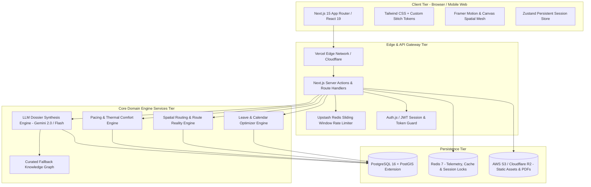
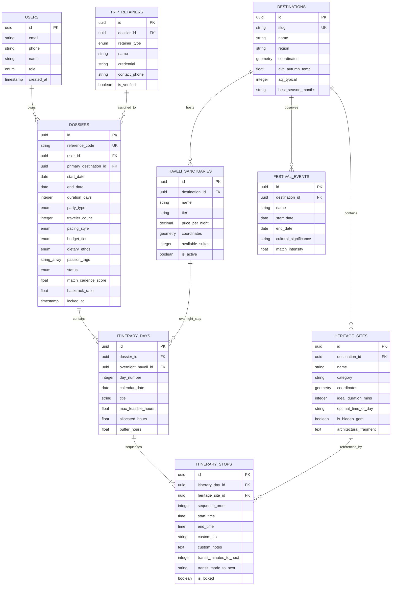
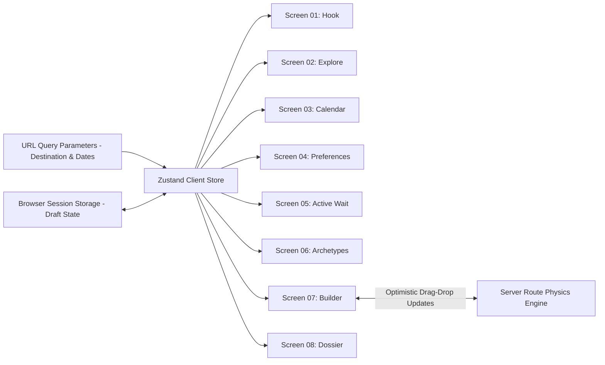

# Comprehensive System Architecture
## Trevoo — High-Fidelity Cultural Travel Planning Platform

---

### 1. System Topography & Stack Decisions



#### 1.1 Technology Stack Selection & Rationale

| Layer | Selected Technology | Rationale & Architectural Fit |
| :--- | :--- | :--- |
| **Frontend Framework** | **Next.js 15 (App Router, React 19)** | Server-side rendering (SSR) for editorial articles & public dossiers (SEO/social unfurls), combined with React Server Components (RSC) and client-side transitions for the 8-stage sequence. |
| **Styling & Tokens** | **Tailwind CSS v3.4 + Custom Stitch Design Tokens** | Translates Stitch design themes directly (Obsidian `#101211`, Parchment `#E7D4BB`, Navy `#002046`, Alert Orange `#F97316`) into strict CSS utility tokens. Zero runtime CSS overhead. |
| **Motion & Micro-interactions** | **Framer Motion 11 + HTML5 Canvas** | Drives the 2.5s prologue sequence, staged 05 synthesis velocity bars, and the animated spatial GIS mesh topology. |
| **Backend & Compute** | **Node.js (Next.js Server Actions & Route Handlers)** | Unified TypeScript types shared across API requests, responses, and UI components. Eliminates schema drift between client and server. |
| **Spatial Database** | **PostgreSQL 16 with PostGIS Extension** | Stores geographical coordinates for havelis, monuments, and stepwells. Executes geometric distance queries (`ST_DWithin`, `ST_DistanceSphere`) to enforce the **0% Backtracking invariant**. |
| **ORM & Migrations** | **Prisma ORM** | Type-safe queries, deterministic database migrations, and clean integration with PostgreSQL types. |
| **In-Memory Cache & Locks** | **Redis (Upstash / Redis 7)** | Caches weather and festival data, provides active waiting telemetry streaming (Stage 05), and handles builder drag-and-drop session locks. |
| **AI / Synthesis Layer** | **Google Gemini 2.0 API (`@google/genai`)** | Powers bespoke narrative generation (curated haveli stories, culinary notes) with strict JSON schema constraints. Backed by a deterministic fallback matrix. |
| **Document Export Engine** | **Puppeteer / Headless Chromium or `@react-pdf/renderer`** | Produces pixel-perfect, printable PDF monographs of confirmed master dossiers (`TRV-YYYY-XXXX`). |

---

### 2. Data Models & Entity-Relationship Schema

#### 2.1 Entity Relationship Diagram (ERD)



#### 2.2 Complete Prisma Schema Definition

```prisma
datasource db {
  provider   = "postgresql"
  url        = env("DATABASE_URL")
  extensions = [postgis()]
}

generator client {
  provider        = "prisma-client-js"
  previewFeatures = ["postgresqlExtensions"]
}

enum UserRole {
  TRAVELER
  CONCIERGE
  DOCENT
  ADMIN
}

enum PartyType {
  SOLO
  COUPLE
  FAMILY_WITH_KIDS
  FRIENDS_GROUP
}

enum PacingStyle {
  RELAXED    // 2-3 stops/day, 65% buffer
  BALANCED   // 4-5 stops/day, 40% buffer
  PACKED     // 6+ stops/day, 15% buffer
}

enum BudgetTier {
  TIER_UNDER_15K    // < ₹15k / day
  TIER_15K_TO_35K   // ₹15k - ₹35k / day
  TIER_35K_TO_75K   // ₹35k - ₹75k / day
  TIER_OVER_75K     // ₹75k+ / day
}

enum DietaryEthos {
  PURE_VEG
  VEG_AND_EGGS
  NON_VEG
  NO_PREFERENCE
}

enum DossierStatus {
  DRAFT
  SYNTHESIZED
  REALITY_LOCKED
  CONFIRMED
  ARCHIVED
}

enum RetainerType {
  PRIVATE_CHAUFFEUR
  RESIDENT_PHYSICIAN
  ARCHIVAL_DOCENT
  CONCIERGE_LEAD
}

model User {
  id        String    @id @default(uuid()) @db.Uuid
  email     String?   @unique
  phone     String?
  name      String?
  role      UserRole  @default(TRAVELER)
  dossiers  Dossier[]
  createdAt DateTime  @default(now()) @map("created_at")
  updatedAt DateTime  @updatedAt @map("updated_at")

  @@map("users")
}

model Destination {
  id               String             @id @default(uuid()) @db.Uuid
  slug             String             @unique
  name             String
  region           String
  latitude         Float
  longitude        Float
  avgAutumnTemp    Float              @map("avg_autumn_temp")
  aqiTypical       Int                @map("aqi_typical")
  bestSeasonMonths String             @map("best_season_months")
  heritageSites    HeritageSite[]
  haveliSanctuaries HaveliSanctuary[]
  festivals        FestivalEvent[]
  dossiers         Dossier[]

  @@map("destinations")
}

model HeritageSite {
  id                     String          @id @default(uuid()) @db.Uuid
  destinationId          String          @db.Uuid @map("destination_id")
  destination            Destination     @relation(fields: [destinationId], references: [id])
  name                   String
  category               String          // CITADEL, STEPWELL, TEXTILE_GUILD, WATERWAY, PALACE
  latitude               Float
  longitude              Float
  idealDurationMins      Int             @map("ideal_duration_mins")
  optimalTimeOfDay       String          @map("optimal_time_of_day") // DAWN, MORNING, AFTERNOON, GOLDEN_HOUR, DUSK
  isHiddenGem            Boolean         @default(false) @map("is_hidden_gem")
  architecturalFragment  String?         @map("architectural_fragment") @db.Text
  itineraryStops         ItineraryStop[]

  @@map("heritage_sites")
}

model HaveliSanctuary {
  id              String         @id @default(uuid()) @db.Uuid
  destinationId   String         @db.Uuid @map("destination_id")
  destination     Destination    @relation(fields: [destinationId], references: [id])
  name            String
  tier            String         // TIER_1_AUTHENTIC, TIER_2_HERITAGE
  pricePerNight   Decimal        @map("price_per_night") @db.Decimal(10, 2)
  latitude        Float
  longitude       Float
  availableSuites Int            @default(4) @map("available_suites")
  isActive        Boolean        @default(true) @map("is_active")
  itineraryDays   ItineraryDay[]

  @@map("haveli_sanctuaries")
}

model Dossier {
  id                   String          @id @default(uuid()) @db.Uuid
  referenceCode        String          @unique @map("reference_code") // e.g. TRV-2026-8842
  userId               String?         @db.Uuid @map("user_id")
  user                 User?           @relation(fields: [userId], references: [id])
  primaryDestinationId String          @db.Uuid @map("primary_destination_id")
  primaryDestination   Destination     @relation(fields: [primaryDestinationId], references: [id])
  startDate            DateTime        @map("start_date") @db.Date
  endDate              DateTime        @map("end_date") @db.Date
  durationDays         Int             @map("duration_days")
  partyType            PartyType       @default(COUPLE) @map("party_type")
  travelerCount        Int             @default(2) @map("traveler_count")
  pacingStyle          PacingStyle     @default(BALANCED) @map("pacing_style")
  budgetTier           BudgetTier      @default(TIER_15K_TO_35K) @map("budget_tier")
  dietaryEthos         DietaryEthos    @default(NO_PREFERENCE) @map("dietary_ethos")
  passionTags          String[]        @map("passion_tags")
  status               DossierStatus   @default(DRAFT)
  matchCadenceScore    Float           @default(98.0) @map("match_cadence_score")
  backtrackRatio       Float           @default(0.0) @map("backtrack_ratio")
  lockedAt             DateTime?       @map("locked_at")
  days                 ItineraryDay[]
  retainers            TripRetainer[]
  createdAt            DateTime        @default(now()) @map("created_at")
  updatedAt            DateTime        @updatedAt @map("updated_at")

  @@index([referenceCode])
  @@map("dossiers")
}

model ItineraryDay {
  id                 String           @id @default(uuid()) @db.Uuid
  dossierId          String           @db.Uuid @map("dossier_id")
  dossier            Dossier          @relation(fields: [dossierId], references: [id], onDelete: Cascade)
  overnightHaveliId  String?          @db.Uuid @map("overnight_haveli_id")
  overnightHaveli    HaveliSanctuary? @relation(fields: [overnightHaveliId], references: [id])
  dayNumber          Int              @map("day_number")
  calendarDate       DateTime         @map("calendar_date") @db.Date
  title              String
  maxFeasibleHours   Float            @default(8.0) @map("max_feasible_hours")
  allocatedHours     Float            @default(6.5) @map("allocated_hours")
  bufferHours        Float            @default(2.5) @map("buffer_hours")
  stops              ItineraryStop[]

  @@unique([dossierId, dayNumber])
  @@map("itinerary_days")
}

model ItineraryStop {
  id                   String        @id @default(uuid()) @db.Uuid
  itineraryDayId       String        @db.Uuid @map("itinerary_day_id")
  itineraryDay         ItineraryDay  @relation(fields: [itineraryDayId], references: [id], onDelete: Cascade)
  heritageSiteId       String        @db.Uuid @map("heritage_site_id")
  heritageSite         HeritageSite  @relation(fields: [heritageSiteId], references: [id])
  sequenceOrder        Int           @map("sequence_order")
  startTime            String        @map("start_time") // e.g. "09:00 AM"
  endTime              String        @map("end_time")   // e.g. "12:00 PM"
  customTitle          String?       @map("custom_title")
  customNotes          String?       @map("custom_notes") @db.Text
  transitMinutesToNext Int           @default(20) @map("transit_minutes_to_next")
  transitModeToNext    String        @default("PRIVATE_CHAUFFEUR") @map("transit_mode_to_next")
  isLocked             Boolean       @default(false) @map("is_locked")

  @@unique([itineraryDayId, sequenceOrder])
  @@map("itinerary_stops")
}

model FestivalEvent {
  id                    String      @id @default(uuid()) @db.Uuid
  destinationId         String      @db.Uuid @map("destination_id")
  destination           Destination @relation(fields: [destinationId], references: [id])
  name                  String
  startDate             DateTime    @map("start_date") @db.Date
  endDate               DateTime    @map("end_date") @db.Date
  culturalSignificance  String      @map("cultural_significance") @db.Text
  matchIntensity        Float       @default(0.95) @map("match_intensity")

  @@map("festival_events")
}

model TripRetainer {
  id           String       @id @default(uuid()) @db.Uuid
  dossierId    String       @db.Uuid @map("dossier_id")
  dossier      Dossier      @relation(fields: [dossierId], references: [id], onDelete: Cascade)
  retainerType RetainerType @map("retainer_type")
  name         String
  credential   String
  contactPhone String?      @map("contact_phone")
  isVerified   Boolean      @default(true) @map("is_verified")

  @@map("trip_retainers")
}
```

---

### 3. API & Interface Specifications

#### 3.1 Endpoint Index

| Method | Endpoint Route | Supported Stitch Screen | Purpose |
| :--- | :--- | :--- | :--- |
| `GET` | `/api/v1/destinations/autocomplete` | Screen 01, Screen 03 | Autocomplete search for Indian corridors and micro-regions. |
| `POST` | `/api/v1/calendar/optimize-window` | Screen 03 | Detects public holiday PTO hacks and festival alignments. |
| `POST` | `/api/v1/preferences/validate` | Screen 04 | Validates party, budget, pacing, and dietary constraints. |
| `POST` | `/api/v1/itineraries/synthesize` | Screen 05 | Initiates async route synthesis and streaming telemetry. |
| `GET` | `/api/v1/itineraries/:id/status` | Screen 05 | Polling or SSE channel for active waiting pipeline progression. |
| `GET` | `/api/v1/itineraries/:id/archetypes` | Screen 06 | Returns the 3 ranked archetypes with pacing fidelity calculus. |
| `PUT` | `/api/v1/itineraries/:id/builder` | Screen 07 | Updates day stop sequence and validates route physics constraints. |
| `POST` | `/api/v1/dossiers/:id/lock` | Screen 08 | Locks itinerary into an immutable verified master dossier. |
| `GET` | `/api/v1/dossiers/:code` | Screen 01, Screen 08 | Fetches public/companion dossier by reference code. |
| `GET` | `/api/v1/dossiers/:code/export-pdf` | Screen 08 | Generates downloadable high-resolution PDF monograph. |

---

#### 3.2 Detailed API Contracts

##### `POST /api/v1/calendar/optimize-window` (Screen 03)
* **Request Payload**:
```json
{
  "destination": "Udaipur & The Aravalli Escarpment",
  "year": 2026,
  "month": 10,
  "requestedDurationDays": 5
}
```
* **Success Response (`200 OK`)**:
```json
{
  "ok": true,
  "data": {
    "recommendedWindow": {
      "startDate": "2026-10-08",
      "endDate": "2026-10-12",
      "durationDays": 5,
      "durationNights": 4,
      "velocity": "OPTIMAL"
    },
    "smartOpportunities": [
      {
        "type": "LONG_WEEKEND_PTO_HACK",
        "holidayName": "Gandhi Jayanti",
        "holidayDate": "2026-10-02",
        "ptoDaysNeeded": 1,
        "unlockedTripDays": 4,
        "savingHoursTransit": 8
      }
    ],
    "culturalAlignments": [
      {
        "festival": "Diwali & Dev Deepawali Wave",
        "window": "2026-10-29 to 2026-11-03",
        "matchPercentage": 98,
        "description": "1,000,000 earthen diyas on Varanasi river steps"
      }
    ],
    "telemetry": {
      "clearSkyPercentage": 94,
      "foliageDensity": "PEAK",
      "crowdDensity": "LOW",
      "averageTempCelsius": 27.0
    }
  }
}
```
* **Error Response (`400 Bad Request`)**:
```json
{
  "ok": false,
  "error": {
    "code": "INVALID_DATE_RANGE",
    "message": "Trip duration must be between 2 and 21 days."
  }
}
```

---

##### `POST /api/v1/itineraries/synthesize` (Screen 04 $\to$ Screen 05)
* **Request Payload**:
```json
{
  "destination": "Udaipur & The Aravalli Escarpment",
  "dates": {
    "startDate": "2026-10-08",
    "endDate": "2026-10-12"
  },
  "party": {
    "type": "COUPLE",
    "travelerCount": 2
  },
  "pacing": "BALANCED",
  "budgetTier": "TIER_15K_TO_35K",
  "dietaryEthos": "PURE_VEG",
  "passionTags": [
    "LIVING_ARCHITECTURE",
    "TEXTILE_GUILDS",
    "SLOW_PHOTOGRAPHY"
  ]
}
```
* **Success Response (`202 Accepted`)**:
```json
{
  "ok": true,
  "data": {
    "dossierId": "c9a28e3b-01d8-4f8e-8a9d-b4ef91823ab4",
    "status": "PROCESSING",
    "estimatedCompletionSeconds": 2.5,
    "streamUrl": "/api/v1/itineraries/c9a28e3b-01d8-4f8e-8a9d-b4ef91823ab4/status"
  }
}
```

---

##### `PUT /api/v1/itineraries/:id/builder` (Screen 07)
* **Request Payload**:
```json
{
  "dayNumber": 2,
  "stopIdsOrdered": [
    "site-amber-palace-sheesh-mahal",
    "site-anokhi-museum-courtyard",
    "site-panna-meena-stepwell"
  ]
}
```
* **Success Response (`200 OK`)**:
```json
{
  "ok": true,
  "data": {
    "dayNumber": 2,
    "allocatedHours": 6.5,
    "maxFeasibleHours": 8.0,
    "bufferHours": 2.2,
    "transitOverheadMinutes": 40,
    "physicsValidation": {
      "hasImpossibleGaps": false,
      "backtrackPercentage": 0.0,
      "status": "OPTIMAL_PACE"
    },
    "stops": [
      {
        "id": "stop-01",
        "sequenceOrder": 1,
        "name": "Amber Palace & Sheesh Mahal",
        "startTime": "09:00 AM",
        "endTime": "12:00 PM",
        "transitToNext": {
          "durationMinutes": 25,
          "mode": "PRIVATE_CHAUFFEUR",
          "trafficStatus": "LOW_TRAFFIC"
        }
      },
      {
        "id": "stop-02",
        "sequenceOrder": 2,
        "name": "Anokhi Museum & Organic Courtyard Cafe",
        "startTime": "01:00 PM",
        "endTime": "03:00 PM",
        "transitToNext": {
          "durationMinutes": 15,
          "mode": "FOOT_TRANSIT",
          "trafficStatus": "SHADED_ALLEY"
        }
      },
      {
        "id": "stop-03",
        "sequenceOrder": 3,
        "name": "Panna Meena Ka Kund Stepwell",
        "startTime": "03:45 PM",
        "endTime": "05:15 PM",
        "transitToNext": null
      }
    ]
  }
}
```
* **Constraint Violation Response (`422 Unprocessable Entity`)**:
```json
{
  "ok": false,
  "error": {
    "code": "ROUTE_PHYSICS_CAPACITY_EXCEEDED",
    "message": "Daily schedule exceeds 8.5 feasible hours. Afternoon thermal reprieve violated.",
    "allocatedHours": 9.2,
    "maxAllowedHours": 8.0
  }
}
```

---

##### `POST /api/v1/dossiers/:id/lock` (Screen 07 $\to$ Screen 08)
* **Request Payload**:
```json
{
  "travelerContact": {
    "name": "Kanishk Modi",
    "email": "kanishk@example.com"
  }
}
```
* **Success Response (`200 OK`)**:
```json
{
  "ok": true,
  "data": {
    "referenceCode": "TRV-2026-8842",
    "status": "REALITY_LOCKED",
    "shareUrl": "https://trevoo.com/dossier/udaipur-oct26-8842",
    "qrCodeDataUri": "data:image/png;base64,iVBORw0KGgo...",
    "assignedRetainers": [
      {
        "type": "PRIVATE_CHAUFFEUR",
        "name": "Omendra Rathore",
        "credential": "Verified by Rajasthan Tourism Board • WhatsApp Active"
      },
      {
        "type": "RESIDENT_PHYSICIAN",
        "name": "Dr. S. K. Mehta",
        "credential": "On-Call Resident Doctor • Geetanjali Medical College"
      }
    ]
  }
}
```

---

### 4. Security & Authorization Model

#### 4.1 Role-Based Access Control (RBAC) Matrix

| Resource / Action | Anonymous Traveler | Authenticated Traveler (Owner) | Companion (Shared Link) | Concierge / Admin |
| :--- | :---: | :---: | :---: | :---: |
| **View Screen 01–06 (Funnel)** | Allow | Allow | Allow | Allow |
| **Synthesize Itinerary** | Allow (Rate limited) | Allow | Deny | Allow |
| **Modify Builder (Screen 07)** | Allow (Session token) | Allow (Owner) | Read-only | Allow (Override) |
| **Lock Master Dossier** | Allow (Captures email) | Allow | Deny | Allow |
| **View Master Dossier (Screen 08)** | Allow | Allow | Allow (Read-only) | Allow |
| **Assign / Edit Retainers** | Deny | Deny | Deny | Allow |
| **Export Master PDF** | Allow | Allow | Allow | Allow |

#### 4.2 Cryptographic Token Lifecycle & Session Handling
1. **Anonymous Session Management**:
   * Users navigating Screens 01 through 07 receive an encrypted `trevoo_session` HTTP-only cookie containing a signed JWT (HMAC-SHA256).
   * Session validity is 7 days.
2. **Dossier Reference Code Cryptography**:
   * Dossier identifiers follow the format `TRV-YYYY-XXXX` where `XXXX` is a cryptographic Base32 Crockford hash derived from `HMAC_SHA256(DossierUUID, SERVER_SECRET)`.
   * Prevents sequential enumeration attacks against client dossiers.
3. **Companion Link Security**:
   * Companion links (e.g., `trevoo.com/dossier/udaipur-oct26-8842`) contain an unguessable slug with a signature token.
   * Companion access grants strict `READ_ONLY` capabilities—destructive mutations (e.g., deleting stops, changing havelis) require owner authentication.
4. **Input Sanitization & Prompt Injection Defense**:
   * All user text injected into LLM synthesis prompts (e.g., custom traveler notes) is strictly sanitized using DOMPurify and validated against strict schemas before being passed to `@google/genai`.

---

### 5. State Management & Data Flow Architecture

#### 5.1 Client-Side State Topology



#### 5.2 State Segregation Rules
* **Ephemeral Local State (React `useState` / `useReducer`)**:
  * Audio mute toggle, mobile navigation drawer open/close, active calendar month view, tooltips.
* **Persistent Session State (Zustand with `sessionStorage` sync)**:
  * Selected start date, end date, party composition, pacing option, budget tier, active passion tags.
  * Allows users to reload or navigate backwards (e.g. from S06 back to S04) without losing calibrated parameters.
* **Server-Synchronized State (React Query / SWR)**:
  * Screen 07 Timeline Stop positions. Changes are dispatched optimistically to the UI and reconciled against `/api/v1/itineraries/:id/builder`.
  * If the Route Reality Engine detects an impossible transit gap, the UI automatically rolls back and surfaces an alert banner.

#### 5.3 Cache Invalidation Matrix
* **Static Assets (CSS, Fonts, Images)**: Cached at Cloudflare / Vercel Edge with `Cache-Control: public, max-age=31536000, immutable`.
* **Destination Telemetry (AQI, Foliage, Weather)**: Cached in Redis with TTL = 6 hours.
* **Festival Alignments**: Cached in Redis with TTL = 7 days.
* **Haveli Room Inventory**: Cached in Redis with TTL = 15 minutes.
* **Confirmed Dossiers (`TRV-YYYY-XXXX`)**: Cached at Edge with `stale-while-revalidate=86400`, invalidated immediately upon owner modification in Screen 07.

